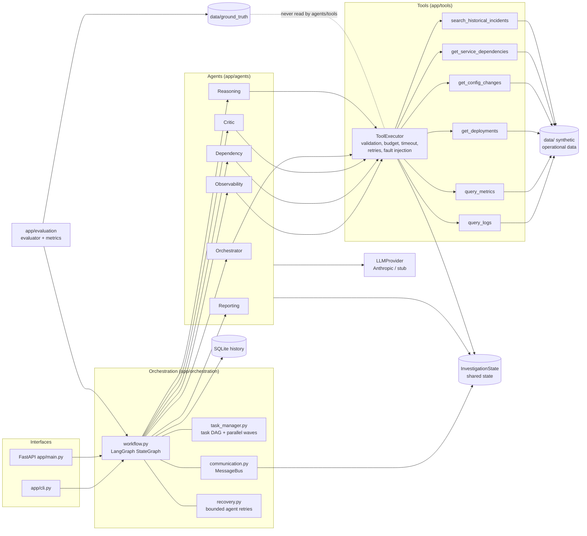
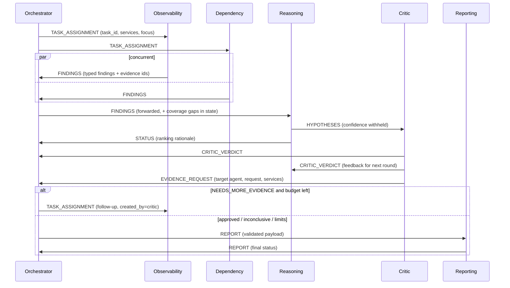
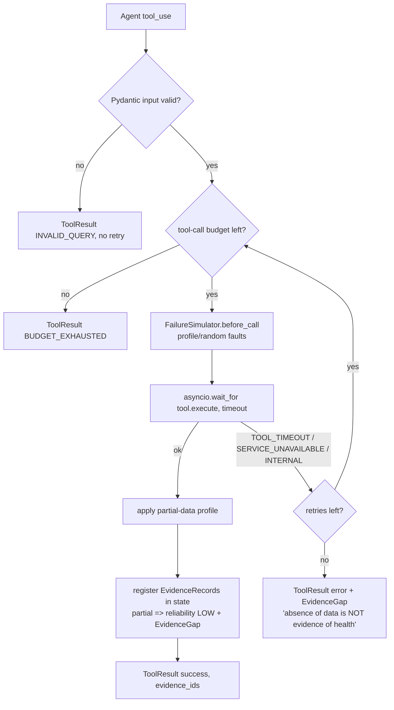
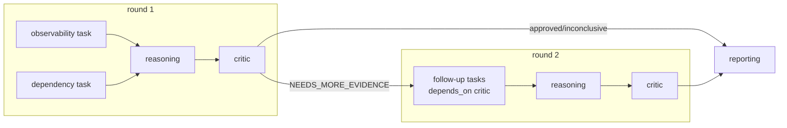
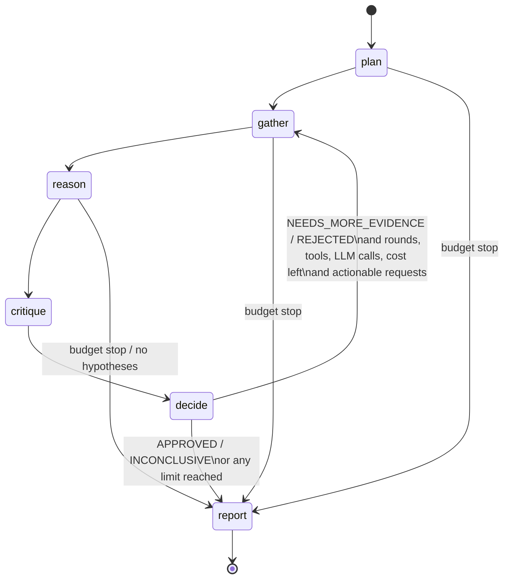
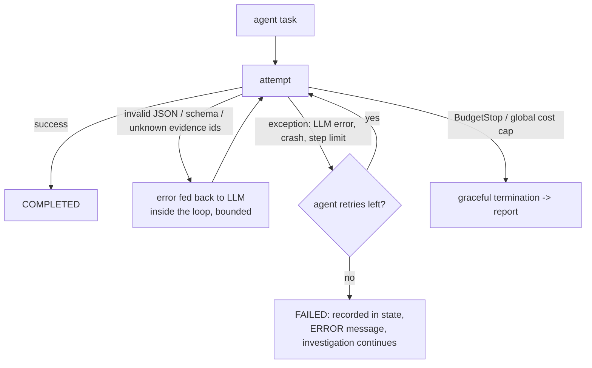
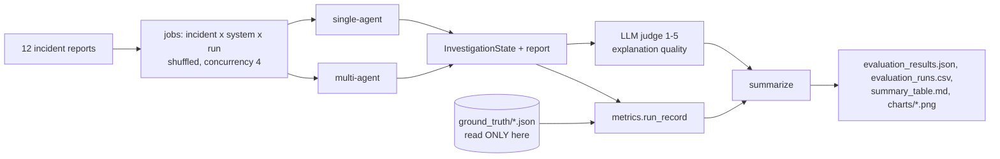

# Architecture

All diagrams describe the code as implemented. Module paths are given so each box can be traced.

## 1. Overall system design

The system is a Python 3.12 service: **LangGraph** drives a 6-node state machine,
**asyncio** provides concurrency, **Pydantic** defines every schema, **SQLite** stores
investigation history, and the **Anthropic SDK** (Claude Haiku 5.5 by default) powers
the agents. A scripted **stub provider** exists only for offline tests.

## 2. Agent responsibilities

| Agent | Module | Tools | Input | Output |
|---|---|---|---|---|
| Orchestrator | `agents/orchestrator.py` | `get_service_dependencies` | `IncidentReport` | `PlanSubmission` → `InvestigationTask`s; deterministic follow-ups, limits, final status |
| Observability | `agents/observability_agent.py` | `query_logs`, `query_metrics` | `InvestigationTask` | `AgentOutput` (typed findings: observed_fact / derived / possible_explanation / missing_evidence / contradiction) |
| Dependency | `agents/dependency_agent.py` | `get_deployments`, `get_config_changes`, `get_service_dependencies`, `query_metrics` | `InvestigationTask` | `AgentOutput` |
| Reasoning | `agents/reasoning_agent.py` | `search_historical_incidents`, `get_evidence` | FINDINGS messages + critic feedback | `Hypothesis` list (confidence computed by `agents/scoring.py`) |
| Critic | `agents/critic_agent.py` | `query_logs`, `query_metrics`, `get_deployments`, `get_config_changes`, `get_evidence` | HYPOTHESES message (confidence stripped) + pre-checks | `CriticVerdict` (APPROVED / NEEDS_MORE_EVIDENCE / REJECTED / INCONCLUSIVE) |
| Reporting | `agents/reporting_agent.py` | none | validated payload (status already decided) | narrative sections; report assembled by `reporting/report_generator.py` |

Each agent is a separate class with its own system prompt, tool subset and a `submit_*`
tool whose JSON schema is the agent's output contract (`agents/base_agent.py`). The
Orchestrator only plans: it never proposes root causes.

## 3. Agent communication

Every message is an `AgentMessage` (`models/agent.py`) with a message ID, sender,
recipient, investigation ID, type, structured payload, timestamp and status
(`delivered`/`consumed`). The bus (`orchestration/communication.py`) stores the messages
in shared state, so the full conversation is persisted and visible through the API. The
Reasoning Agent builds its input only from its inbox, which is what makes the
collaboration real: `tests/test_multi_agent.py::test_agents_genuinely_collaborate` shows
that removing the specialists' findings changes the hypotheses.

## 4. Shared state

`InvestigationState` (`models/investigation.py`) holds the incident, config, plan,
tasks (with `depends_on`), agent statuses, messages, the evidence registry (keyed by
evidence ID), evidence gaps, findings, hypotheses (plus history across rounds), critic
verdicts, the round counter, every tool call record, execution statistics (tool calls,
failures, retries, partials, agent failures, invalid LLM outputs, token usage per
agent), the timeline, errors, the final status and the report. Completed states go to
SQLite (`storage/repository.py`).

## 5. Tool architecture

Every tool returns `ToolResult{success, data, error, is_partial, warnings,
execution_time_ms, attempts, evidence_ids}`. Simulated timeouts actually exceed the
executor's timeout, so the real `asyncio.TimeoutError` path runs. Fault profiles live in
`data/failures/<ID>.json`, for example INC-009 (metrics timeouts, partial logs,
deployment service unavailable) and INC-010 (partial logs).

## 6. Parallel execution and task DAG

`TaskManager.run_wave` runs every ready task concurrently with `asyncio.gather` under a
semaphore (`config.parallelism`). Inside an agent, multiple `tool_use` blocks in one
LLM turn also execute concurrently. The DAG looks like this:

A failed dependency does not block its dependents, which continue with whatever
evidence is available.

## 7. Investigation workflow and critic feedback loop

**Critic loop.** The Critic returns `evidence_requests` with a target agent, the request
and the services. The Orchestrator turns up to three of them into follow-up tasks for
the next round. Specialists then gather new evidence, which updates the shared registry,
and the Reasoning Agent reruns with the previous hypotheses and the critic feedback in
its briefing. The Critic re-reviews the result. `max_rounds` bounds the loop.

## 8. Failure recovery

Specific fallbacks:
- Planner failure: a default plan.
- Critic failure: a pre-checks-only `NEEDS_MORE_EVIDENCE` verdict, so nothing is ever auto-approved.
- Reporting failure: a deterministic narrative.
- Investigation timeout: the report is built from current state, without the LLM.

## 9. Evidence-grounding strategy

1. Evidence IDs are only ever created by tools: `met-…`, `logpat-…`, `log-…`, `dep-…`, `cfg-…`, `topo-…`, `hist-…`.
2. Specialists' submissions are rejected if they cite IDs that don't exist, and the agent gets the error back.
3. Hypothesis confidence comes from `scoring.py` using only the cited, existing evidence: reliability-weighted support, contradiction penalties, temporal precedence against the data-derived onset, gap and failure penalties, and the critic adjustment. Every component is written to `score.explanation`.
4. Critic pre-checks block hallucinated citations, causes that come after the onset, support that rests only on correlation, and support that is only historical.
5. The report labels every statement CONFIRMED FACT, OBSERVED EVIDENCE, INFERENCE, ASSUMPTION or UNKNOWN, and marks whether each cited ID exists.

## 10. Termination conditions

The investigation stops when any of these happens:
- The Critic returns APPROVED or INCONCLUSIVE.
- `max_rounds` is reached.
- The tool-call budget runs out.
- The LLM-call budget or the investigation cost budget runs out.
- The global spend cap is hit.
- `investigation_timeout_s` passes.
- Reasoning fails with no hypotheses available.
- Every evidence agent fails.

The final status comes from `OrchestratorAgent.decide_final_status`:

| Status | Condition |
|---|---|
| `ROOT_CAUSE_IDENTIFIED` | Critic approved, confidence ≥ 0.6 and margin ≥ 0.1 |
| `PROBABLE_ROOT_CAUSE` | Approved with a lower score, or NEEDS_MORE_EVIDENCE at the limit with an unblocked leader ≥ 0.5 |
| `INCONCLUSIVE` | Otherwise |
| `INVESTIGATION_FAILED` | All evidence gathering failed |

## 11. Single-agent baseline

`evaluation/single_agent.py` runs one LLM loop with **all six tools**. It uses the same
`ToolExecutor` (same budget, timeouts and fault injection), the same model and effort,
and the same limits; its step allowance is 3× an agent's. It has no orchestrator,
specialists, critic, message bus, pre-checks or deterministic scoring. It decides its
own final status and self-reports confidence. Its report goes through the same report
generator so both systems are graded the same way.

## 12. Evaluation methodology

See [evaluation.md](evaluation.md) for metric definitions and results.
